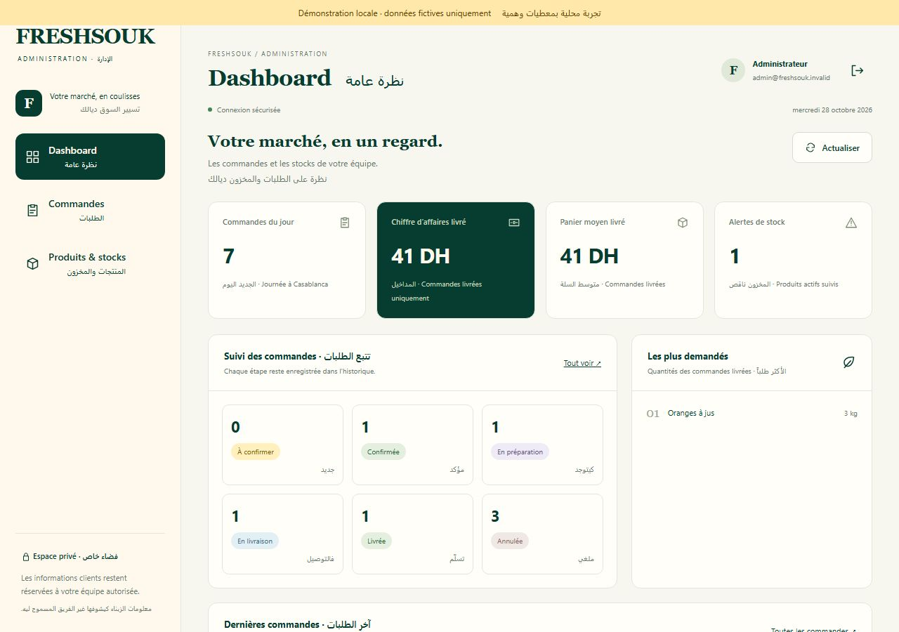
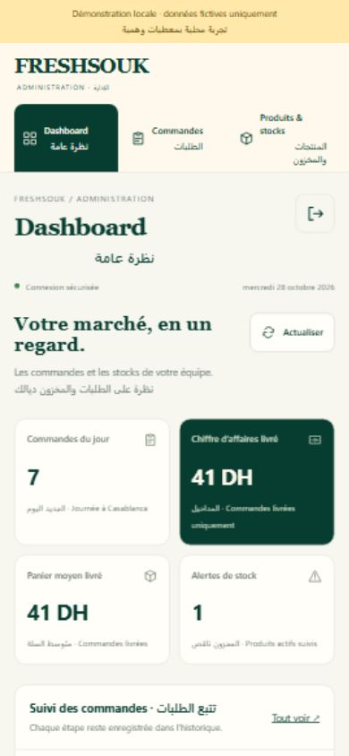

# Vérifications — 28 octobre 2026

## Périmètre et résultat local

Base : `main@2e1a874f940dbe3b61ecb06b682db68ef6469add`, conforme aux huit fichiers principaux récupérés sur GitHub Pages. Les 96 fichiers d’origine sont inchangés. Aucun compte client réel, secret, base distante ou export réel n’a été utilisé.

Commandes exécutées avec Node.js 24 :

```sh
node admin/scripts/build-assets.mjs
node admin/scripts/check-assets.mjs
node admin/scripts/verify-public.mjs
node --check admin/ui/app.js
node --test --test-isolation=none admin/tests/*.test.mjs
```

Résultat : **14 tests réussis, zéro échec** ; 32 images approuvées seulement dans les assets ; 96 blobs d’origine préservés. Les assertions couvrent les vrais JWT RSA et les refus d’accès/CSRF, les erreurs de certificats, les limites JSON, les données autorisées, le captcha et sa liaison hostname/action, l’intake désactivé, les reçus minimaux, les prix serveur, l’idempotence et les réservations concurrentes, le rollback SQL, les conflits de version, l’annulation avec restitution unique, les snapshots, les agrégats et les exports CSV neutralisés. SQLite réel et transactions, pas de mock SQL permissif.

## Parcours réels dans le navigateur

Prévisualisation liée uniquement à `127.0.0.1`, données fictives signalées en haut de chaque page. Interface française/arabe conservée.

| Parcours | Résultat observé |
| --- | --- |
| Dashboard ordinateur, largeur 1 280 px | Indicateurs, répartition des statuts et derniers produits livrés cohérents avec les commandes fictives ; aucun débordement de page. |
| Produits | Catalogue initial de 32 produits ; prix des bananes modifié à 12,50 DH, stock suivi à 8 kg, motif enregistré ; historique avant/après consulté. |
| Commande manuelle | Création d’une demande fictive d’un kilo de bananes : 12,50 DH + 20 DH de livraison = 32,50 DH calculés au serveur ; détail consulté. |
| Statuts | Confirmation et annulation effectuées ; historique affiché ; stock restitué et commande terminale. Une case de confirmation explicite est requise pour annuler. |
| Mobile, largeur 390 px | Navigation entre les trois écrans, détail et annulation d’une commande fictive ; formulaire de création d’un produit à 9,50 DH et stock 2 kg ; archivage, puis présence du statut « Archivé » vérifiée. |
| Petit mobile, largeur 320 px | Largeur scroll et largeur visible toutes deux à 320 px : pas de débordement global. Les grandes tables défilent dans leur propre conteneur. |
| Console | Aucun avertissement ni erreur pendant les parcours contrôlés. |

Captures du même jeu fictif :





## Limites de cette validation

La recette locale ne remplace pas les vérifications Cloudflare : login réel IdP/MFA, politiques Access, bindings D1, limites réseau et transactions sur D1 distante, expiration/déconnexion et restauration privée doivent être validés dans une préproduction autorisée. Aucun appareil iPhone/Android physique n’a été utilisé : les contrôles mobile sont réalisés par viewport navigateur.

Le workflow CI réalise aussi une compilation Wrangler `--dry-run`, sans secret ni création de ressource. Son état final est visible dans les checks de la Pull Request. Aucun déploiement, aucune fusion, aucune activation du checkout public. Configuration externe et étapes après accord : [SETUP.md](SETUP.md).

## Recette de préproduction autorisée — 28 octobre 2026

Après accord explicite du propriétaire, une nouvelle D1 et un Worker de préproduction ont été créés hors de GitHub Pages. Access protège tout le nom d'hôte avec une politique propriétaire unique, session de politique et MFA TOTP d'une heure. L'enrôlement Authenticator et le consentement OAuth Wrangler ont été validés par le propriétaire. Aucun secret n'a été ajouté au dépôt.

La connexion réelle Access/MFA a révélé deux incompatibilités corrigées : les JWT Access peuvent omettre l'en-tête JOSE facultatif `typ` ; Workers accepte `redirect: 'manual'` plutôt que `error`. Les JWT conservent les contrôles obligatoires RS256/signature, issuer, audience, durée, identité d'application et email autorisé. Les redirections des services de clés et de captcha ne sont jamais suivies et leurs réponses non-2xx sont refusées. Les 14 tests repassent avec les régressions correspondantes.

| Contrôle distant | Résultat |
| --- | --- |
| D1 dédiée | Schéma, sept triggers et 32 produits vérifiés ; deux migrations enregistrées dans le ledger après vérification de leur application. Ancienne base inchangée. |
| Refus sans session | UI, JS, image, commandes, produits, catalogue et health renvoient 302 vers Access ; aucune donnée privée retournée. |
| Accès propriétaire | Authenticator demandé, connexion réelle puis Dashboard et catalogue chargés depuis D1. |
| Commande fictive privée | Un kilo de tomates à 8 DH + 20 DH = 28 DH ; stock fictif 3 kg → 2 kg vérifié directement dans D1. |
| Confirmation et annulation mobile | Transitions enregistrées dans l'historique, commande terminale annulée, stock restitué à 3 kg. Aucun client réel ni notification externe. |
| Restauration après recette | Produit remis au catalogue initial : 8 DH, stock non suivi, quantité zéro. La commande clairement marquée TEST reste annulée dans l'historique privé. |
| Isolation | Intake public désactivé, 36 assets autorisés seulement, Worker exécuté avant les assets, URLs de version désactivées. Main et les 96 blobs publics restent inchangés. |

Cette préproduction est une recette autorisée, pas une activation du checkout public. L'expiration réelle après une heure, la restauration Time Travel et un téléphone physique restent à vérifier avant une mise en production. La Pull Request reste Draft et non fusionnée.
